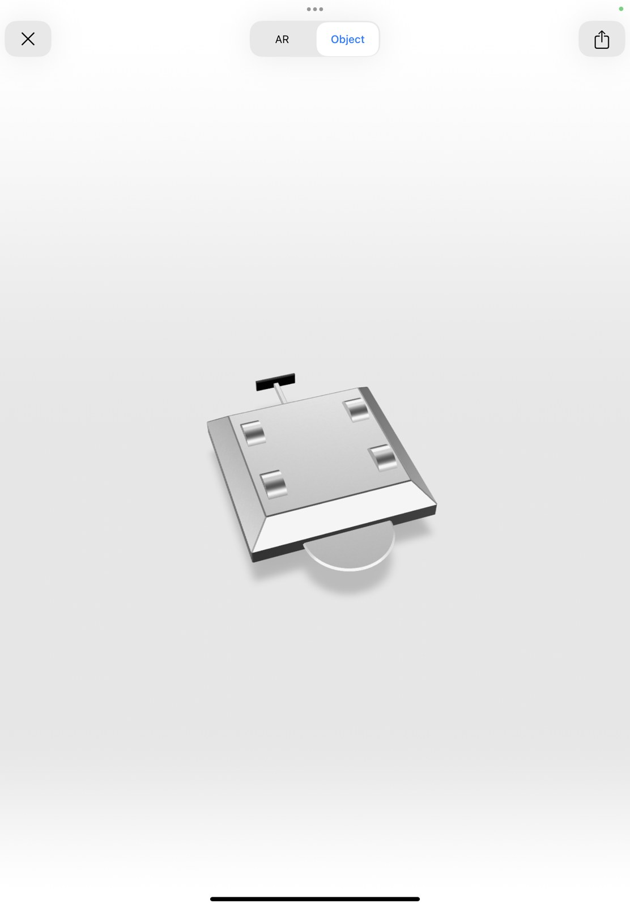

# Robowar Combat Robot

A competition-style robot project represented by chassis CAD screenshots and a photograph of a fabricated metal chassis. The materials document the mechanical layout and fabrication stage.

**Portfolio:** Thiruppathi P · [Thirusprojects](https://github.com/Thirusprojects)

## Project status

CAD screenshots and physical chassis evidence available. A completed operational robot or competition result is not documented in this upload.

## Contribution

Personal design, fabrication and integration responsibilities are awaiting confirmation.

## Design and documented features

- Low-profile chassis concept shown in CAD screenshots.
- Fabricated metal structure with internal divisions.
- Mechanical design and construction documentation.

## Image gallery

- [Project image 1](media/images/img-0027.jpg)
- [Project image 2](media/images/img-0028.jpg)
- [Project image 3](media/images/img-0029.jpg)
- [Project image 4](media/images/img-3815.jpg)

## Evidence and limitations

Drive motors, controller, battery, weapon mechanism, weight class and competition participation require confirmation. No competitive results or completed functional tests are claimed.

## Details to complete

Confirm your contribution, weight class, drivetrain and control hardware, operational status and any event participation.

## File provenance

See [asset inventory](docs/ASSETS.md) for the mapping to supplied filenames. JPEG and MP4 exports are provided for browser access. Original presentation, PDF and CAD contents are retained where supplied.

This repository documents project materials supplied by the portfolio owner. Team work and third-party design contributions should be credited as their roles are confirmed.
