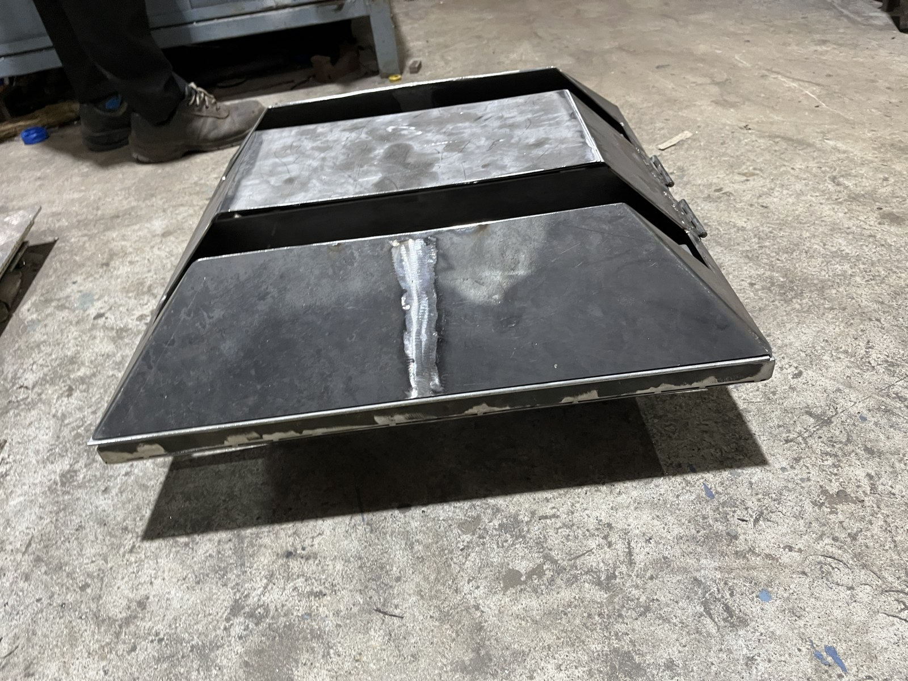
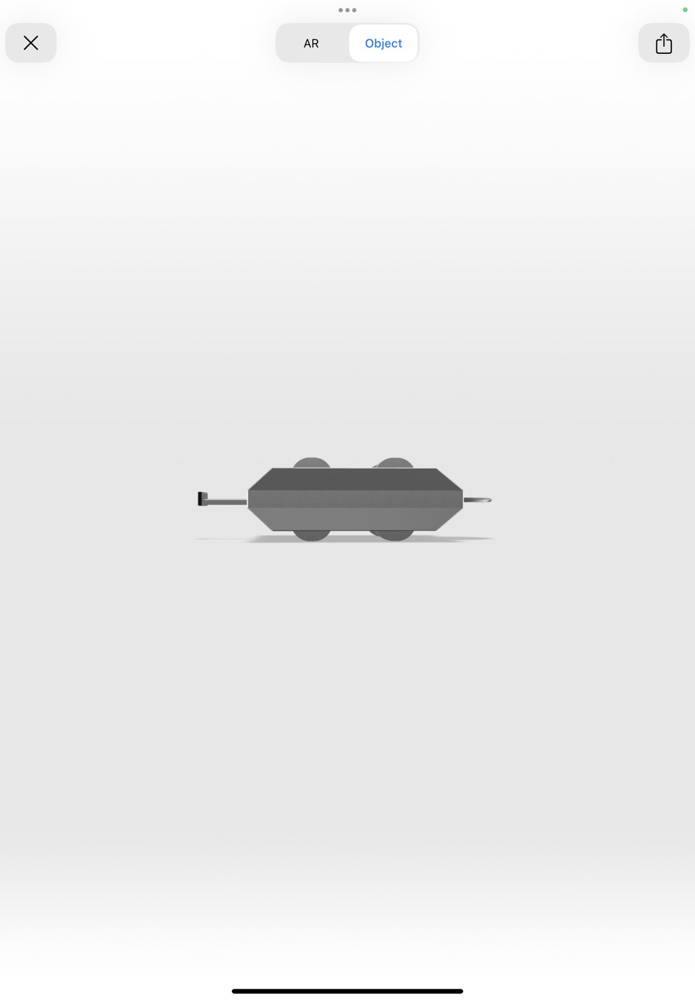
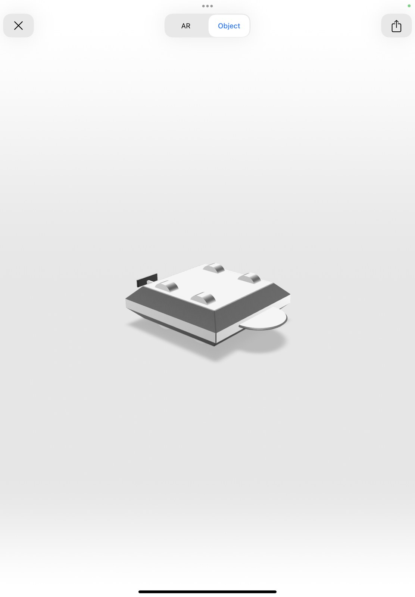

# Robowar Combat Robot

A team-built robot with a custom chassis and a **four-motor drive arrangement**, using one motor for each wheel. The team completed the robot build and fabricated the chassis.

## My contribution

I **designed the chassis**. Our team built the chassis and completed the robot, bringing the mechanical structure and four-wheel drive system together.

## Drivetrain and construction

Each of the four wheels was connected to its own motor. The build used **48 V electric motors of the type used in cycles or electric vehicles**, with ESCs rated at approximately **120 A**.

| Item | Details |
| --- | --- |
| Chassis | Custom design; fabricated by the team |
| My confirmed contribution | Chassis design |
| Drive arrangement | Four motors, one per wheel |
| Motors | 48 V electric motors |
| ESC rating | Approximately 120 A |
| Build status | Complete robot built |

The ESC figure is a component rating, not a measured operating current. Motor model, battery specification, competition weight class and any weapon mechanism are not specified here.

## Chassis design views

